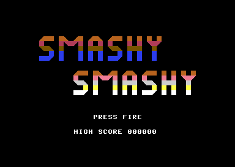
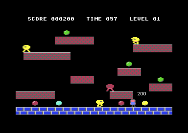
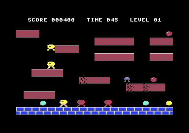
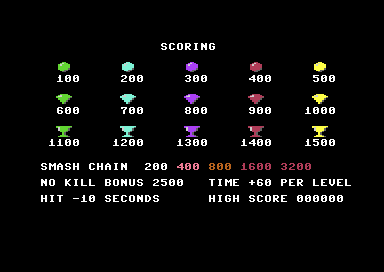

# Smashy Smashy

A single-screen platformer for the **Commodore 64**, designed by Rev. Layle and written in [Prog8](https://github.com/irmen/prog8) by Claude (Anthropic's AI model), driven by a written spec and built in phases.

Run, jump, and **smash down** through brick platforms to collect 10 treasures per level before the clock runs out. Enemies chase you, steal treasures and run off with them, and can be bonked or smashed for points. Every level is generated procedurally.

> **How was this made?** See [docs/development-story.md](docs/development-story.md): how a one-page design note became a spec, a phase plan and a series of AI coding sessions, and which tools made that work.

<p>
  
  
</p>
<p>
  
  
</p>

## Getting started

You need **Python 3.8+** and an internet connection. Everything else is downloaded into the project folder by a setup script; nothing is installed system-wide.

```
python tools/setup.py        # Java 21, Prog8 12.3.4, 64tass, VICE (Windows), C64 reference texts
build.cmd run                # Windows
./build.sh run               # Linux / macOS
```

The build converts the art, compiles `src/main.p8` to `build/main.prg`, and `run` starts it in VICE with the keyboard mapped to joystick port 2.

- **Windows** is fully tested.
- **Linux and macOS** need VICE and 64tass from your system: the setup script detects them, or tells you exactly what to install (Linux: the VICE Flatpak `net.sf.VICE`, and `build-essential` so it can build 64tass; macOS: `brew install vice tass64`). The Linux/macOS path is written but not yet tested.

Just want to play? Grab `main.prg` from the [Releases](../../releases) page and open it in any C64 emulator, or on a real PAL C64.

## Playing

| Input | Action |
|---|---|
| Left / right | Run (full control in the air too) |
| Fire | Jump; hold for higher, up to 96 px |
| Down in the air | Smash down (fast-fall): cracks a brick, a second smash breaks it |
| Land on an enemy | Bonk it: it drops any treasure it carries |
| Smash down onto an enemy | Destroy it; chain kills in one dive for 200, 400, 800, 1600, 3200 |
| Run/Stop | Pause |

Keyboard in VICE: arrow keys and left Ctrl (from `tools/vicerc`), or any gamepad set up as joystick 2.

Scoring: treasures 100-1500, smash chains as above, +2500 for finishing a level without destroying an enemy. Every level adds 60 s to the clock; getting hit costs 10 s. The game is over when time runs out.

The game is built for PAL machines (50 Hz). On NTSC it runs about 20% faster.

## Repository map

| Path | What |
|---|---|
| `platformer-game.txt` | Rev. Layle's original design notes |
| `docs/spec.md` | Technical spec: every gameplay rule, number, memory address and data format, with the decisions made along the way |
| `docs/phases.md` | The build plan, and each phase's notes: what was built, how it was tested, what was measured |
| `docs/session-prompts.md` | The prompts used to start each coding session |
| `docs/development-story.md` | How it was all made |
| `AGENTS.md` | Standing instructions for AI coding agents (any tool); `CLAUDE.md` imports it for Claude Code |
| `.claude/skills/` | Prog8 language and 6502 assembly guides (from the Prog8 project, GPL-3.0) |
| `docs/c64/` | C64 hardware references (VIC-II article, *Mapping the C64*, memory and I/O maps), downloaded by the setup script, not stored in git |
| `src/` | The game, 14 Prog8 modules (see below) |
| `assets/` | Sprites and tiles as editable text art |
| `tools/gfx.py` | Converts the text art into binary graphics and a Prog8 constants file |
| `tools/setup.py` | Downloads the toolchain and reference texts |
| `build.cmd`, `build.sh` | Build (and run) scripts for Windows and Linux/macOS |

Source modules:

| Module | Role |
|---|---|
| `main.p8` | Game flow (attract pages, levels, game over) and the built-in self-test scenarios |
| `video.p8` | VIC-II setup (bank 3, multicolour), tile and HUD drawing, frame IRQ, screen shake |
| `input.p8` | Joystick and keyboard matrix, edge detection, scripted input for tests |
| `actors.p8` | Shared movement and tile collision for the player and enemies |
| `player.p8` | Player states: run, variable jump, fast-fall, launches, floating back |
| `enemies.p8` | Enemy movement, contact rules, respawn, treasure carrying and dropping |
| `nav.p8` | Platform map, route finding, enemy roles (chaser, ambusher, hunter, carrier) |
| `levelgen.p8` | Procedural levels with reachability checks for player and enemies |
| `score.p8` | BCD score (in hundreds), timer, level, high score |
| `popup.p8` | Floating score popups |
| `title.p8`, `pages.p8` | Title screen and the attract pages |
| `sound.p8` | Table-driven SID sound effects |
| `gen_assets.p8` | Generated by `tools/gfx.py`, not edited by hand |

## Using a different AI agent

The project was built with Claude Code, but nothing in it requires Claude:
- **`AGENTS.md`** holds all agent instructions: build, test, coding rules, workflow. It's the cross-tool convention read by opencode, OpenAI Codex, Cursor, GitHub Copilot's agent and others. `CLAUDE.md` is a one-line import of it.
- **The Prog8 guides** in `.claude/skills/` are plain Markdown. Claude Code loads them automatically; with other agents, point them at the files (`AGENTS.md` already lists them).
- **The workflow** (spec → phases → one session per phase → designer playtests → commit) lives entirely in `docs/`, and works with any agent that can read files, run commands and look at a screenshot.
- **Smaller or local models** do better with smaller tasks: one phase item at a time, with a build after every change.

For a fresh Prog8 project set up this way from the start, see the separate prog8-ai-kit (not yet public).

## Toolchain

`tools/setup.py` puts everything in `tools/` (ignored by git):
- Prog8 12.3.4, pinned. The game was built and tested with it, and works around two of its compiler bugs (see the spec).
- A portable JDK 21. Prog8 needs Java 17 or newer.
- 64tass 1.60 (or any 64tass 1.58+ already on the PATH).
- VICE 3.10 on Windows.
- A shallow clone of the Prog8 source at the same version, for its manual and library source.

## License

The game, tools and documentation in this repository are under the [MIT License](LICENSE), © 2026 Rev. Layle.

Exceptions and credits:
- The skills in `.claude/skills/` are from the [Prog8 project](https://github.com/irmen/prog8) and are GPL-3.0.
- Programs compiled with Prog8 are explicitly excluded from Prog8's GPL by its author, so the built game can be shared freely.
- The C64 reference texts are not included; the setup script downloads them from [mist64/c64ref](https://github.com/mist64/c64ref) and zimmers.net.
