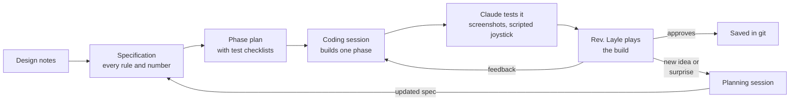
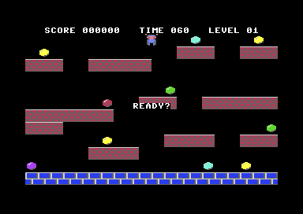

# How Smashy Smashy was made

Smashy Smashy is a Commodore 64 game built in about a day and a half by its designer, Rev. Layle, working with Claude, an AI model, through a written specification, a step-by-step plan and a series of separate AI coding sessions. This is the story of how that worked, which tools made it possible, and what we learned.

**In numbers**
- 31 saved versions (git commits), from the first baseline on October 15 at 12:19 to the last feature on October 16 at 11:25.
- About 5,500 lines of program code in 14 files, including a large set of built-in self-tests.
- A 440-line technical specification and a 440-line build log.
- The finished game uses about 26 KB of the C64's 64 KB of memory, and never misses a screen refresh.

## A few C64 terms used below

- **Frame:** the C64 redraws the screen 50 times a second (European PAL machines). A smooth game does all its work for one frame (moving the player, the enemies, checking collisions) before the next redraw starts.
- **Raster lines:** the screen is drawn line by line, 312 lines per frame. Measuring "how many lines went by" while the game does its work is the standard way to tell how much of the frame budget is used. Over 312 means the game misses a frame and stutters.
- **Cycles:** the C64's processor runs about a million steps (cycles) per second; one frame is about 19,700 of them.
- **Sprites:** the C64 can draw 8 small movable images on top of the background. The player, the 5 enemies and 2 score popups use all 8.
- **KERNAL:** the C64's built-in operating system in read-only memory. Among other things, it scans the keyboard 50 times a second.
- **VICE:** a widely used C64 emulator. Claude ran the game in VICE without a window and saved screenshots to check its own work.
- **Prog8:** a programming language that compiles to C64 (and Commander X16) machine code, by Irmen de Jong.

## Who did what

- **Rev. Layle** (human) designed and owns the game. They wrote the original design notes, made every gameplay decision, played every build and approved each version. They know Prog8 and could review the code, but asked Claude to write it.
- **The planning session** (Claude) was one long conversation with Rev. Layle. It set up the project, turned the design into a specification, planned the work in phases, measured what the hardware could afford, and answered questions throughout. It wrote plans, not game code.
- **Coding sessions** (Claude) were fresh conversations, usually one per phase. Each started knowing nothing, read the project's documents, built one phase, tested it, and stopped for Rev. Layle to play it.

Sessions don't share memory. **The project's documents were the only thing connecting them**, and that shaped how everything was written down.

## 1. Starting questions: which language?

The project began with two questions: *which programming language gets the most out of Claude*, and *what C64 documentation should be on hand?*

The language choice took three rounds:
1. Claude first suggested **6502 assembly**, the C64's native machine language, for full control.
2. Rev. Layle pushed back ("assembly is a bear"), so the discussion moved to **C**. They pointed out that the usual C compiler for the C64 produces slow code.
3. Rev. Layle mentioned having used **Prog8** a lot, and that the Prog8 project includes guides written for AI agents. Claude checked, found guides written by Prog8's author, and recommended Prog8: Rev. Layle could read and review the code, the compiler catches mistakes early, and the guides cover the language's details.

**Lesson:** the right tool depended on the human as much as on the machine. A language Rev. Layle could read made real review possible.

## 2. Setting up the tools

Rev. Layle wanted the newest versions, kept inside this project, without disturbing an older setup. Claude:
- **Found the newest stable Prog8 (12.3.4).** It needed a newer Java than the computer had, so Claude put a private copy of Java inside the project rather than changing the system.
- **Installed the VICE emulator** and checked that the assembler was current.
- **Downloaded Prog8's source code at the matching version** for its manual, standard library and AI guides, so the documentation always matched the compiler.
- **Collected the classic C64 references as searchable text:** the VIC-II graphics chip article by Christian Bauer, *Mapping the Commodore 64*, and the *Programmer's Reference Guide* memory maps. An index file tells later sessions to look facts up rather than rely on memory.
- **Wrote `CLAUDE.md`,** a file Claude Code reads at the start of every session: how to build, which Java to use, coding rules, and where everything is.

**Then came the feedback loop:** compile a small test program, run it in VICE without a window, save a screenshot, and look at it. From then on, Claude could check its own work visually.

## 3. A quick proof: a sprite and a joystick

Before any design work, Rev. Layle asked for a small sample to see whether the basics worked. Claude looked up every hardware register and library routine in the actual Prog8 library before using it. The program compiled on the first try, and the screenshot showed the sprite. Rev. Layle then tried the joystick in VICE: it worked.

## 4. From design notes to a specification

Rev. Layle wrote a one-page design (`platformer-game.txt`): a single-screen platformer with randomly generated levels, 10 treasures, 5 enemies and a timer, plus a variable-height jump and a "fast-fall" that smashes the platform you land on.

Claude turned it into a technical specification (`docs/spec.md`) covering memory layout, data formats, movement speeds, scoring and game flow. Two markers made it workable:
- **[DECIDE]**: a proposal waiting for Rev. Layle's answer. Every gap in the notes became one, collected in a list at the end.
- **[TUNE]**: a starting number expected to change once the game could be played.

Then came question rounds, answered by number ("#2 sounds fine", "#3 keep falling through"). Highlights:
- **No floating-point math.** Rev. Layle pointed out that decimal-point math is very slow on the C64. Claude reworked positions and speeds into whole numbers with small fractions stored separately. That became a standing rule for every session.
- **Enemies couldn't climb back up.** The design had enemies jumping half as high as the player, which wasn't enough to climb between platform layers. Instead of adding stairs to every level, Rev. Layle raised both jumps.
- **Many small rules,** each written down with its reason: how high you bounce off an enemy, steering in the air but not during a fast-fall, breaking through a cracked block, the clock running while you float back after being hit, colorful "multicolor" graphics, and placeholder art Rev. Layle can edit as plain text.

**Lesson:** writing every open question down meant gameplay was never guessed. Rev. Layle spent minutes answering; the coding sessions rarely had to stop and ask.

## 5. Phases and the hand-off

Rev. Layle wanted the coding done in separate sessions. That needed a plan any fresh session could pick up:

- **The phase plan (`docs/phases.md`)** has 8 phases. Each lists what to build and a **"Done when" checklist** of things the session must prove itself, and each ends with something playable. A short "How to work a phase" section sets the routine:
  1. Take the next unfinished phase.
  2. Prove every check.
  3. Write notes: what changed, what was measured, what's still rough.
  4. Stop for Rev. Layle.
  5. Save a version only after approval.
- **Scripted joystick:** an AI session can't hold a joystick. So the first phase built a test switch that replays a recorded list of joystick moves. With screenshots taken at chosen moments, a session could prove things like "the jump peaks at exactly 96 pixels" on its own. Feel (speed, responsiveness, fun) was always listed for Rev. Layle instead.
- **Ready-made prompts (`docs/session-prompts.md`)** for Rev. Layle to paste: start the next phase, fix things after playtesting, resume an interrupted phase, launch the game.
- **A fresh start each phase.** Rev. Layle asked whether to clear Claude's memory between phases. Yes: everything needed is in the documents, and a clean start avoids confusion from old details. A session stays open only while Rev. Layle playtests and asks for fixes in that phase.
- **Version control (git)** was added after phase 2, with the rule "save a version when Rev. Layle approves".

## 6. The build, phase by phase

| Phase | What was built | Notable moments |
|---|---|---|
| 1. Graphics foundation | Screen setup, colorful tile graphics, score bar, art converter | Art is drawn as text in plain files and converted automatically, so anyone can edit it in a text editor |
| 2. Player movement | Running, variable jump, fast-fall, standing on platforms | The scripted joystick proved the jump height to the pixel |
| 3. Smashing, treasures, score, timer | Cracking and breaking blocks, scoring, countdown | Rev. Layle added a highlight on the block a fast-fall will hit. They also noticed every score is a multiple of 100, so the score is now stored in hundreds with "00" shown after it, a cheaper way to reach six digits |
| 4. Level generator | Random levels, checked to be fully reachable | A 200-level automatic test: every level valid, each made in a fraction of a second |
| 5a. Enemies | Enemies, stomping ("bonks"), smash kills with chain bonuses, getting hit | The first version overran the frame budget. Fixed, partly by rewriting the sprite update as hand-tuned assembly: almost 4× faster |
| 5b. Enemy navigation | Enemies plan real routes across the level, in different roles | Every planned jump was replayed with the real physics on thousands of levels: no failures. Rev. Layle noticed enemies gathering on the floor; higher enemy jumps fixed it |
| 6. Treasure thieves | Enemies grab treasures and flee; bonk them to get the treasure back | Thieves run to the far side of the level, away from the player |
| 7. Game flow | Title screen, "READY?", levels, pause, high score | Rev. Layle added screen shake on every smash. A gameplay loophole showed up (below) |
| 8. Art, animation, sound | Animated characters, six sound effects | The smash rule was tuned in play |

  
  

> [!NOTE]
> **All the graphics you see are AI-generated placeholder art**, drawn by Claude as plain text grids, one character per pixel (`assets/sprites.txt`, `assets/tiles.txt`). The sound effects are Claude's too. Phase 1 deliberately built the art pipeline so a human can redraw any sprite or tile in a text editor and simply rebuild: no code changes, no special tools. Real artwork can also come from tools like SpritePad or CharPad later.

After phase 8 Rev. Layle kept playing and asking for improvements. Each became a **one-off change** with its own short written spec and prompt:
- a new title screen
- floating score numbers
- fairer collisions
- readable score numbers
- smarter thieves
- "attract mode" pages that explain how to play

## 7. Questions, measurements and surprises

Much of the planning session's work happened between phases. Some examples:

**Could the C64 afford smart enemies?** Before building them, Claude measured how much of each frame the game already used: **58 of 312 lines**. That left room for a real route-planning system, which Claude designed with enemy roles: chasers, an ambusher that heads where the player is going, and treasure hunters. The enemy work was split into two phases to keep each change manageable. Rev. Layle added that an enemy holding a treasure should **run away**, turning recovery into a chase.

**Should the game switch off the C64's operating system?** Rev. Layle suspected the KERNAL's keyboard scanning was wasting time. Claude wrote a small timing test: it cost about **1% of each frame**. Not worth removing the KERNAL, but worth skipping its keyboard routine, which was done in phase 7. The measurement also pointed at a bigger cost inside the game's own sprite update, which was then sped up almost fourfold.

**Level generation got slower.** Making sure enemies can always reach every part of a level made generating it take up to 2-3 seconds. Rev. Layle's answer was a **3-second "READY?" pause** before each level, which hides the work completely.

**The "drill hop."** Rev. Layle found that holding down and pressing jump smashed the platform you were standing on: a tiny hop, then an instant smash. Two sensible rules had combined into a loophole. Claude laid out the options, and Rev. Layle chose a **minimum fall distance** before a smash does damage. It was tuned in play to 8 pixels.

**Unreadable score numbers.** Several scores at once (destroying a thief and catching its treasure, or smashing three stacked enemies) produced overlapping numbers. The fix shows one combined total for events in quick succession, and stacks separate numbers above each other. Claude also spotted a hidden cost: drawing the numbers three times in one frame could have caused a stutter. Drawing them at most once per frame removed the risk.

**Thieves moved as a pack.** Every thief used the same "where to hide" rule, so they all ran to the same spot, and one smash collected everything. Rev. Layle asked whether enemies should block each other. Claude advised against it: it would cost speed, cause traffic jams, and remove the big multi-enemy combos the design notes wanted. The real fix was in the decision-making: each thief now **claims its own hiding place** and picks with some randomness.

**Lesson:** playing every build found problems no plan anticipated. The planning session's job was to find the cause in the actual rules and numbers, offer options with trade-offs, and write the chosen fix down clearly enough for a fresh session to build.

## 8. Several sessions at once

Sometimes a coding session was running while the planning session wrote up the next change. To keep them from overwriting each other's work:
- **New changes went into separate files** (one short spec per change). The session that built a change merged it into the main specification and deleted the file.
- **The planning session checked for work in progress** before editing anything, and saved only its own file when another session was mid-task.
- **Once, a specification edit landed while another session was mid-phase.** That session saved it along with its own work. It worked out, but it showed why separate files are safer.

## 9. Tools that made it work

| Tool | New or existing | What it did |
|---|---|---|
| Prog8 compiler and 64tass assembler | existing | Turn the program into C64 machine code |
| VICE emulator | existing | Ran the game without a window and took screenshots: Claude's eyes |
| Prog8's AI guides | existing (from the Prog8 project) | Language rules, loaded whenever Claude wrote code |
| C64 reference texts | existing | Exact hardware facts, looked up instead of remembered |
| `CLAUDE.md` | new | Standing instructions read by every session |
| Specification, phase plan, session prompts | new | The plan, the progress log and the hand-off between sessions |
| Text-art converter | new | Lets art be drawn and edited as plain text |
| Scripted joystick | new | Recorded inputs for tests |
| Numbered test scenarios (34 of them) | new | Repeatable setups with on-screen readouts, rerun after changes to catch anything that broke |
| Frame budget meter | new | Measured the worst frame in raster lines and counted missed frames |
| Cycle timer | new | Measured exactly how long a single routine takes |
| Mass tests | new | Hundreds of generated levels checked automatically; every enemy jump route tried with the real physics |
| git | existing | A saved version for every approved step |

Two bugs in the Prog8 compiler turned up along the way. Both were worked around and recorded so they can be reported.

## 10. A spin-off: prog8-ai-kit

Rev. Layle asked whether this setup could be shared: Prog8 developers on the Commander X16 Discord had struggled to get AI tools, including models running locally, to build Prog8 programs. The reusable parts became a separate starter kit:
- a one-command tool installer for Windows, Linux and macOS
- a simple `p8` command to build, test and screenshot programs
- project templates any AI tool can follow
- guides for the development loop and the C64 and X16 hardware

While testing the kit on the X16, Claude reproduced a likely cause of the Discord users' trouble: one missing line (`%encoding iso`) makes normal text come out garbled, which looks like a broken program. Techniques from this game, such as spreading heavy work over several frames and the testing patterns, went into the kit's guides.

## 11. For Prog8 developers: the technical details

If you write Prog8 yourself, these are the parts most likely to be useful. The full details are in `docs/spec.md` and the phase notes in `docs/phases.md`.

- **Setup for the AI:**
  - `CLAUDE.md`: build commands and coding rules.
  - Prog8's own `prog8-coder` and `asm6502-coder` skills (from the Prog8 repo at the matching tag).
  - A shallow clone of the Prog8 source, searched for exact library signatures. Claude was told never to guess a routine name.
- **Memory layout:**
  - VIC-II in bank 3: screen at `$C000`, charset at `$E000` and sprites from `$E800`, in the RAM under the KERNAL ROM. CPU writes there go to RAM even with the ROM banked in.
  - That leaves `$0801-$BFFF` for the program, guarded with `%memtop $C000`.
  - Prog8's `txt.*` routines are hard-wired to `$0400`, so the game draws its own text.
  - `$CFE0-$CFFF` is Prog8's virtual registers on the C64 too.
- **Numbers:**
  - No floats (they also keep BASIC banked in).
  - Positions are a whole pixel plus a 1/16-pixel fraction byte; speeds are signed bytes.
  - Score in hundreds as a 4-digit BCD `uword`, shown with "00" appended, using the `bcd` module.
  - `math.randrange()` does a 16-bit multiply; masking `math.rnd()` and retrying was much cheaper.
- **The frame:**
  - A raster IRQ (`sys.set_rasterirq`) copies sprite shadow registers and counts frames. It doesn't chain to the KERNAL, which measured 161-204 cycles per frame.
  - The sprite copy as a Prog8 `for` loop took **1,046 cycles**; as an unrolled 64tass `.for` copy, **278**.
  - Final worst frame: 283 of 312 raster lines, measured in scripted stress scenarios, with a late-frame counter to catch dropped frames.
- **Heavy work, spread out:**
  - The enemy navigation map rebuilds a few slices per frame into a second set of tables, only while the frame still has time, then swaps them in.
  - Enemy decisions are staggered so at most one enemy decides per frame.
- **Testing without a joystick:**
  - `input.SCRIPTED` replays (frames, joystick bits) pairs.
  - `main.TEST` selects one of 34 scenarios with a fixed seed and an on-screen readout.
  - VICE runs headless with `-limitcycles` and `-exitscreenshot`.
- **Prog8 12.3.4 issues hit:**
  - Indexing a label (e.g. `chars[0]` where `chars:` labels `%asmbinary` data) crashes the compiler; `@(&chars + i)` works.
  - `actors.x[0] > actors.x[i] + 4` on a split word array miscompiled; copying to locals first fixed it.
  - Also, not a bug but a trap: a regular `sub` whose body ends with an `%asm` block gets no automatic `rts` from Prog8. The popup code fell through into the next routine until an explicit `return` was added.

## 12. In Rev. Layle's words

I grew up with a C64 for almost the entirety of the 1980s, up to 1992, even, before I gave it all away. During those years of ownership I played games, wrote school papers, made my own little games, and even tried to publish a couple of games thru Compute! (Too young at the time and inexperienced to make a game good enough for publishing). Over the years, I found C64 emulators to play C64 games that I couldn't do on hardware anymore. 

Fast forward to 2025, and now I have in my possession: a Commodore 64 Ultimate and a renewed interest in C64 games. I had already dabbled in development of C64 programs for a couple of years now. **prog8** was my language of choice. It had a small but growing set of fans on the Commander X16 Discord, and the maintainer kept making improvements to code generation and language features.

I am a Software Engineer by day, and in my current position, I use LLM spec/code generation workflows a lot to finish new features and fix bugs. It was a pretty successful workflow that generates what I want most of the time, with proper review. For this project, I thought, what if I can apply the same workflows here?

So I started a quick little experiment on:
- How well can Claude (Opus 5.5 on a $20 USD/month Pro account) create prog8 code?
- How well can Claude understand the C64 architecture?
- Can I use some of the workflows I use at work and for other project experiments (as a reference, I have done a longer term experiment making a Phantasie II clone in C# and Monogame using these workflows)?

About a day and a half later, we get this little game, Smashy Smashy (yeah, I named it that). To be honest, it came out better than expected. Most of the prog8 code is reasonably readable. Is it the best that can be done? I'll leave it to C64 and prog8 experts that are not me to decide that.

What you see in the game - besides the initial specifications, requirements drift, scope creep, human testing and review - is all generated by an LLM.

## 13. What worked

- **Rev. Layle decides, Claude proposes.** Every open question came with a recommendation. Gameplay rules came from Rev. Layle; numbers and implementation came from Claude, marked for tuning where play should decide.
- **The documents are the memory.** The specification, phase notes, prompts and `CLAUDE.md` let any fresh session continue with no conversation history.
- **Claude proves what it can, the human judges the rest.** Every phase listed checks Claude could prove alone (positions, scores, timing) and things only a person could judge (feel and fun).
- **Measure before deciding.** Timing measurements settled the operating-system question, showed the AI was affordable, and caught slowdowns before they reached Rev. Layle.
- **Small steps.** Phases sized for one session, the enemy work split in two, a separate change for every new idea, and a saved version to return to after each.
- **Play every build.** Many of the best improvements came from Rev. Layle playing, not from the original plan: the smash loophole fix, smarter thieves, readable scores, the READY? pause, the new title screen.

For the full detail behind any of this, see `docs/spec.md` (every rule and number, with the reasons) and `docs/phases.md` (what each session built, tested and measured).
